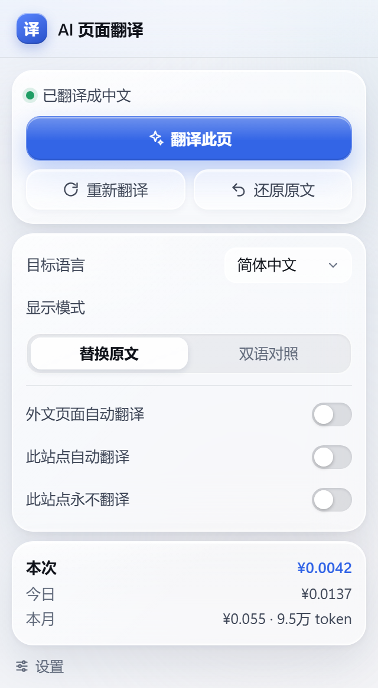
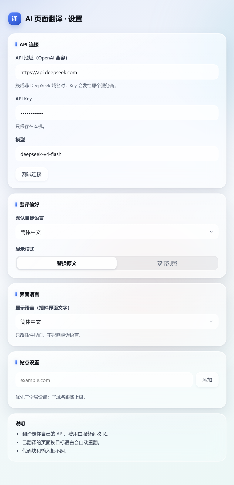

# AI 页面翻译

用 DeepSeek 翻译整页网页的浏览器扩展，支持 Edge / Chrome（Manifest V3）。需要自备 API Key。

## 做什么

整页文字交给模型翻译，术语和语气能跨段落保持一致。大页面分批并发翻；SPA 跳页、动态加载和 Shadow DOM 里的新内容会自动跟上。翻完可以一键还原。

代码块、输入框、iframe 不动；评论只翻正文，作者名和时间保留。也可以切成"原文 + 译文"对照看。

## 截图

| 翻译前 | 翻译后 |
|---|---|
|  |  |

| 深色模式 | 双语对照 |
|---|---|
|  |  |

| 弹窗 | 设置 |
|---|---|
|  |  |

## 安装

1. 下载 [Releases](../../releases) 里最新的 zip，解压
2. 打开 `edge://extensions`（Chrome 用 `chrome://extensions`）
3. 打开"开发人员模式"，点"加载解压缩的扩展"，选解压出的文件夹（里面有 `manifest.json`）
4. 点扩展图标 → 设置，填 DeepSeek 的 API Key

装完可以关掉开发人员模式。更新版本时再打开，重新加载一次。

## 使用

打开外文网页，顶部会出现提示条，点"AI 翻译"开始，随时能取消。翻译完成后可以显示原文、重新翻译，或只重试失败的段落。

站内跳页时新内容会自动翻译。手动取消或还原后，本页不再自动续翻。

## 设置

- **API Key**：在 [DeepSeek 开放平台](https://platform.deepseek.com)申请，只保存在本机。
- **模型**：默认 `deepseek-v4-flash`。
- **目标语言**：11 种。
- **显示模式**：替换原文，或原文/译文对照。
- **站点设置**：按域名设"自动翻译"或"永不翻译"。

## 费用

用自己的 API 额度，按 token 计费。弹窗里能看到本次、今日、本月的花费，按官方价格和峰谷时段算。

## 隐私

API Key 存在本机扩展存储里，只会发给你在设置里填的 API 地址。翻译时网页文本会发给该服务商；除此之外没有网络请求，也没有遥测。

## 项目结构

```
extension/   可直接加载的扩展
screenshots/ README 截图
dist/        发布 zip
```

没有构建步骤。

## 许可

MIT。部分代码在 AI 辅助下完成。

不是 DeepSeek 官方产品；翻译结果由模型生成，重要内容请对照原文。
