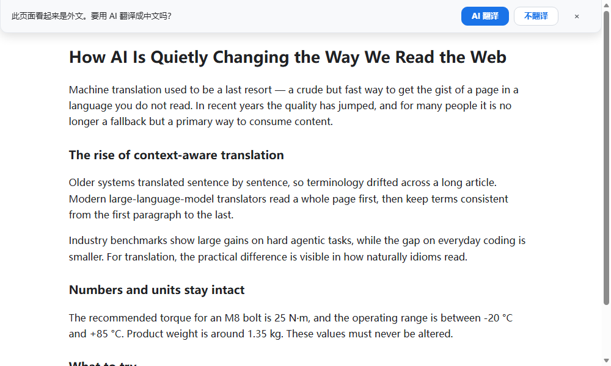
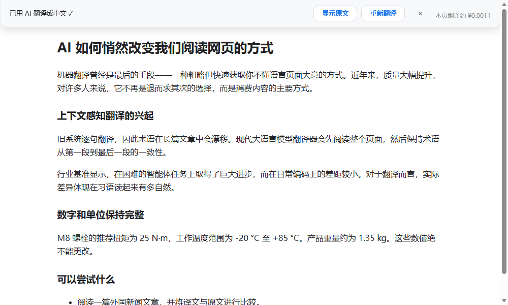
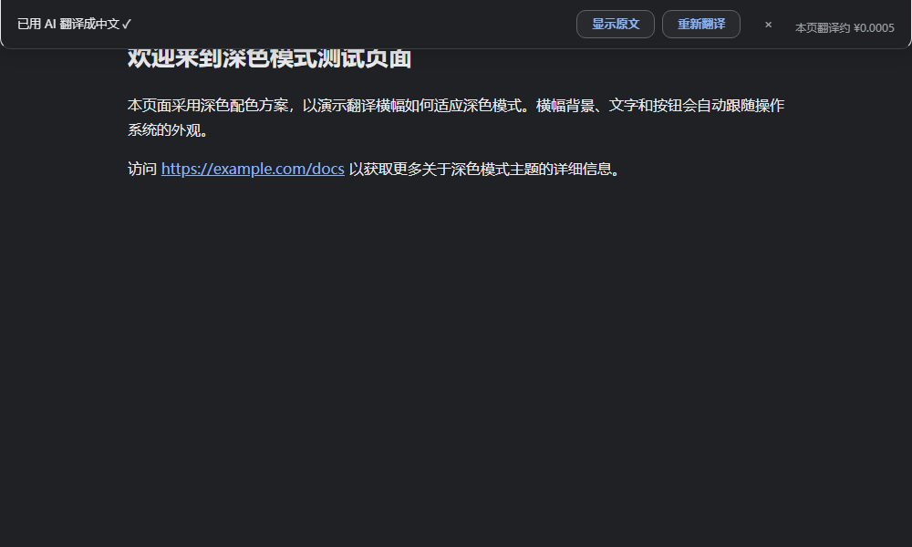
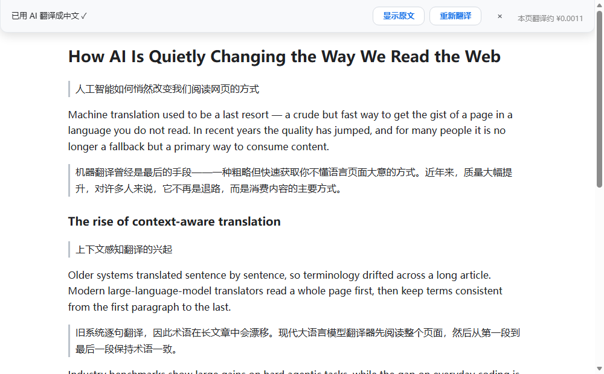

# AI 页面翻译（AI Page Translator）

[English](README.en.md) · 中文

> 用 AI 把整个网页翻译成你选择的语言。
> 由 **DeepSeek** 大模型驱动，需要自备 DeepSeek API Key。

浏览器扩展（Manifest V3），兼容 Edge / Chrome。翻译时能看到全文语境，术语跨段落保持一致，SPA 动态内容也能实时跟上。

## 功能特性

| 特性 | 说明 |
|---|---|
| **AI 自然翻译** | 整页进入大模型翻译，语句通顺、符合中文语感，不是逐句机翻 |
| **全文语境** | 小页面整页一次翻译；大页面先分析全文"翻译方向"再分批，**术语跨段落一致**（实测 "X200 drone" 全文统一译"X200无人机"） |
| **自适应并发** | 大页面自动并发翻译，实测提速 **2~7 倍**（arXiv 8 万字符 226s → 52s） |
| **增量翻译** | SPA 跳页 / 动态加载 / Shadow DOM / 标签页切换 / hash 导航的新内容**自动翻译**，无需手动再点 |
| **失败自动修复** | 偶发的 API 返回异常自动重试收敛；仍失败的一键"重试失败段落"补翻 |
| **跨重启还原** | 扩展更新 / 重载后，已翻译页面仍可"显示原文"还原，不用重翻 |
| **双语对照** | 可切换"双语对照"显示模式——保留网页原文，译文以独立行显示在每段下方（左侧分隔线），适合看文献 / 学外语 / 需核对原文；默认仍是"替换原文" |
| **实体 / 悬停链接保留** | 带 tooltip 或指向战队 / 选手 / 赛事资料页的链接不会被改动，避免"悬停提示"被搬到错误的单词上 |
| **评论元数据不翻** | 评论区只翻译正文句子，作者 / 时间 / 日期 / 国旗 / 用户名等数据标签保留原文，不再与正文错位 |
| **实时进度** | 横幅节点级进度条 + 工具栏角标百分比，随时可取消 |
| **用量统计** | 记录**今日/本月**真实 token 用量，并按**最新官方价 × 高峰/空闲**算出**真实人民币花费**（区分缓存命中/未命中/输出），无需估算 |
| **多语言** | 支持简体中文 / 繁体中文 / English / 日本語 / 한국어 等 11 种目标语言 |
| **深色模式** | 横幅 / 弹窗 / 设置页均适配系统深色模式 |
| **站点设置** | 可按站点设置"总是自动翻译 / 永不翻译"，优先级高于全局 |
| **隐私友好** | API Key 只存本机、只发往 DeepSeek 官方，无任何遥测上报 |

## 截图

| 询问是否翻译 | 翻译完成（浅色） | 深色模式 | 双语对照 |
|---|---|---|---|
|  |  |  |  |

## 安装

**方式一：加载发布包（推荐）**

1. 下载 [Releases](../../releases) 里的 `ai-page-translator-v1.7.3.zip`，解压
2. 打开 `edge://extensions`（Chrome 为 `chrome://extensions`）
3. 打开左下角 **"开发人员模式"**
4. 点击 **"加载解压缩的扩展"**，选择解压出来的 `extension` 目录
5. 点扩展图标 → 选中本插件 → 在小面板中选择下方"设置" → 填 DeepSeek API Key → 测试连接

> 安装完成后可以关闭"开发人员模式"，扩展会继续正常工作；之后如需更新扩展版本，再打开该模式重新加载即可。

**方式二：本地构建（开发者）**

```bash
git clone https://github.com/Bingl1ng/ai-page-translator
# 无需任何构建步骤，extension/ 目录本身就是可直接加载的扩展
```

## 配置说明

在扩展设置页可以配置：

- **API Key**：在 [DeepSeek 开放平台](https://platform.deepseek.com) 申请（`sk-` 开头）。Key 只保存在本机 `chrome.storage.local`。
- **模型**：默认 `deepseek-v4-flash`（已自动关闭思考模式，速度快、成本低、稳定）。如有特殊需求可在设置里改为其它 DeepSeek 模型。
- **目标语言**：默认简体中文，可换 11 种语言。
- **显示模式**：`替换原文`（默认，译文直接替换网页原文）或 `双语对照`（保留原文，译文在每段下方）。
- **自动翻译**：打开外文页面时是否自动翻译（默认关）。
- **站点设置**：例如对某个网站"永不翻译"或"总是自动翻译"。

## 使用

1. 打开一个外文网页 → 页面顶部出现横幅：**"此页面看起来是外文，要用 AI 翻译成中文吗？"**
2. 点击 **"AI 翻译"** → 横幅变为"正在用 AI 翻译… n/m"，可随时**取消**
3. 翻译完成：**"已用 AI 翻译成中文 ✓"**
4. 翻译完成后横幅提供三个操作：
   - **显示原文**：一键还原
   - **重新翻译**：用当前配置重翻整页
   - **重试失败段落**：仅补翻失败的部分（有失败时才出现）
5. 在站内跳页 / 点击动态加载的内容 → **新内容自动翻译**，无需手动操作

> 提示：翻译过程中点击**取消**，或手动**还原**后，本页不再自动续翻，需重新点"AI 翻译"。

## 隐私与安全

- **Key 不外传**：API Key 只存在本机扩展存储，只发往你配置的 API 地址（默认 DeepSeek 官方 `https://api.deepseek.com`）。加载解压版可在代码里直接审计（无打包混淆）。
- **内容发送**：翻译的本质是把网页文本发送给 DeepSeek 做翻译。**请勿在包含敏感/机密信息的页面上使用**。
- **无遥测**：扩展不会上报任何使用数据，唯一的网络请求是发给翻译 API 的文本。
- **自定义 API 地址**：默认只访问 DeepSeek 官方域名。若在设置里改用其它 OpenAI 兼容地址，扩展会请求该域名的访问权限（浏览器会弹窗确认）——请只填你信任的服务商。
- **建议**：在 DeepSeek 控制台**单独创建一个专用 Key**（不要复用主账号的 Key），并设置额度上限——即使泄漏，损失有上限，且可随时吊销重建。

## 费用

- 使用**你自己的 DeepSeek API 额度**，按 token 计费（定价极低，且**高峰时段外半价**——周一至周五 9:00-12:00、14:00-18:00 为高峰，其余时间与周末为优惠价）。
- 弹窗可直接看**「今日 / 本月 / 本次」真实花费（人民币）**——按**最新官方价 × 峰谷时段**计算，区分**输入缓存命中 / 未命中 / 输出**三种单价，是实测真值而非估算。
- 实测翻译一篇 arXiv 论文全文（约 8 万字符）仅几厘人民币（空闲时段通常不足 1 分钱）。

## 项目结构

```
extension/    可直接加载的扩展本体（无构建步骤）
  manifest.json
  content.js   内容脚本：采集/分批/增量翻译/横幅
  background.js  Service Worker：调 DeepSeek API/用量统计/角标
  config.js    共享配置与工具
  options.*    设置页
  popup.*      弹窗
  icons/       图标
screenshots/   README 截图
dist/          发布用 zip
```

## 版本历史

见 [CHANGELOG.md](CHANGELOG.md)。

## 许可证

[MIT License](LICENSE)

> 本项目由作者本人设计、决策与验收，开发过程中部分代码借助 AI 辅助完成。

## 免责声明

本扩展为个人开源项目，**非 DeepSeek 官方产品**，使用其公开 API。请遵守 [DeepSeek 服务条款](https://platform.deepseek.com/terms) 以及你所翻译网站的使用条款。翻译结果由 AI 生成，请以原文为准。
